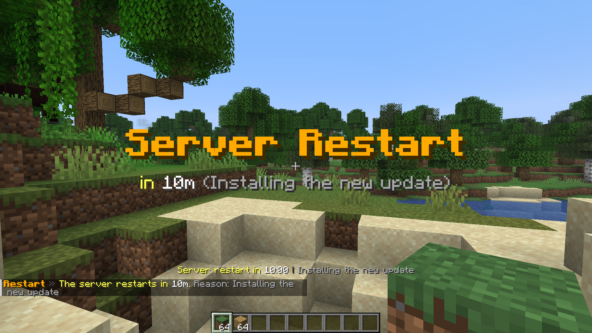

<p align="center">
  <picture>
    <source media="(prefers-color-scheme: dark)" srcset="assets/betterrestarts-lockup-dark.svg">
    
  </picture>
</p>

<p align="center"><b>Scheduled server restarts with a real countdown.</b></p>

<p align="center">
  
  
  
  <a href="LICENSE"></a>
</p>

<p align="center">
  <a href="https://github.com/YONN2222/BetterRestarts"></a>
  <a href="https://github.com/YONN2222/BetterRestarts/stargazers"></a>
  <a href="https://github.com/YONN2222/BetterRestarts/releases"></a>
  <a href="https://github.com/YONN2222/BetterRestarts/issues"></a>
  <a href="https://github.com/YONN2222/BetterRestarts/pulls"></a>
</p>

<p align="center">
  <a href="https://modrinth.com/plugin/better-restarts">Modrinth</a>
  <a href="https://hangar.papermc.io/YONN2222/BetterRestarts">Hangar</a>
  <a href="https://github.com/YONN2222/BetterRestarts/releases">GitHub Releases</a>
</p>

> BetterRestarts is a small open source plugin that restarts your server on a schedule you pick, with a countdown everybody can see. One jar runs on Spigot, Paper, Purpur and Folia. No accounts, no dependencies.

BetterRestarts restarts your server on a schedule you pick. Type `/restart 10m`, and everybody sees an action bar countdown, titles at 10, 5 and 1 minute and a big countdown for the last 10 seconds. Then the server restarts on its own.



## Features

- `/restart <time> [reason]` with free time input like `now`, `30s`, `5m`, `1h30m`, with tab completion
- Action bar countdown for everybody, also for players who join during the countdown
- Titles at 10, 5 and 1 minute, a title countdown for the last 10 seconds, chat reminders and sounds
- Run the command again during a countdown and it is simply updated, `+5m` and `-1m` change it relatively
- `/restart cancel`, `/restart status` and `/restart reload`
- Automatic restarts at fixed times and weekdays, with their own countdown
- Several restart methods: plain shutdown, Spigot restart, a panel API call or any console command
- Replaces the built-in `/restart`, so nothing conflicts
- 10 languages and every message is editable
- Every display, timing and sound can be changed or switched off

## Requirements

- Any Bukkit based server on Minecraft 1.21 or newer: Spigot, Paper, Purpur, Folia and forks of them
- Java 21 or newer

## Quick start

1. Put the jar into `plugins` and start the server.
2. Run `/restart 10m Update` to try it.
3. Cancel with `/restart cancel`.

All permissions default to operators and work with any permissions plugin. See [Installation](docs/installation.md) for details.

## Bringing the server back

BetterRestarts can only stop the server. Minecraft cannot start itself again, so your host, panel or start script has to bring it back up. Most hosts do this by default. See [Restart methods](docs/restart-methods.md).

## Documentation

| | Topic | About |
|---|---|---|
| <picture><source media="(prefers-color-scheme: dark)" srcset="assets/icons/install-dark.svg"></picture> | [Installation](docs/installation.md) | Requirements and first steps |
| <picture><source media="(prefers-color-scheme: dark)" srcset="assets/icons/commands-dark.svg"></picture> | [Commands and permissions](docs/commands.md) | Time format, changing a countdown, permissions |
| <picture><source media="(prefers-color-scheme: dark)" srcset="assets/icons/countdown-dark.svg"></picture> | [Countdown and announcements](docs/countdown.md) | Action bar, titles, chat, sounds |
| <picture><source media="(prefers-color-scheme: dark)" srcset="assets/icons/schedule-dark.svg"></picture> | [Automatic restarts](docs/schedule.md) | Fixed times and weekdays |
| <picture><source media="(prefers-color-scheme: dark)" srcset="assets/icons/methods-dark.svg"></picture> | [Restart methods](docs/restart-methods.md) | Shutdown, Spigot, panel, command |
| <picture><source media="(prefers-color-scheme: dark)" srcset="assets/icons/config-dark.svg"></picture> | [Configuration reference](docs/configuration.md) | Every option and its default |
| <picture><source media="(prefers-color-scheme: dark)" srcset="assets/icons/languages-dark.svg"></picture> | [Languages](docs/languages.md) | Ten languages, custom texts, placeholders |
| <picture><source media="(prefers-color-scheme: dark)" srcset="assets/icons/help-dark.svg"></picture> | [Troubleshooting](docs/troubleshooting.md) | Common problems |

## Building

```
./gradlew build
```

The jar ends up in `build/libs`. Java 25 is used to build, the plugin itself targets Java 21.

## Privacy

BetterRestarts reports anonymous usage statistics to [bStats](https://bstats.org/plugin/bukkit/BetterRestarts/34723). Turn it off for all plugins in `plugins/bStats/config.yml`. Nothing else leaves your server, the only network call is the optional panel restart.

## License

GPL-3.0, see [LICENSE](LICENSE).
