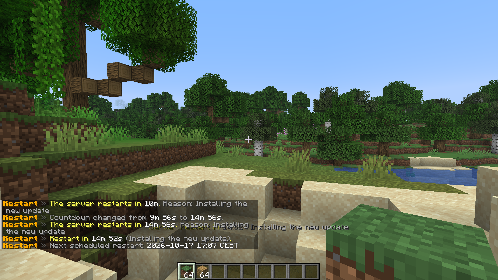
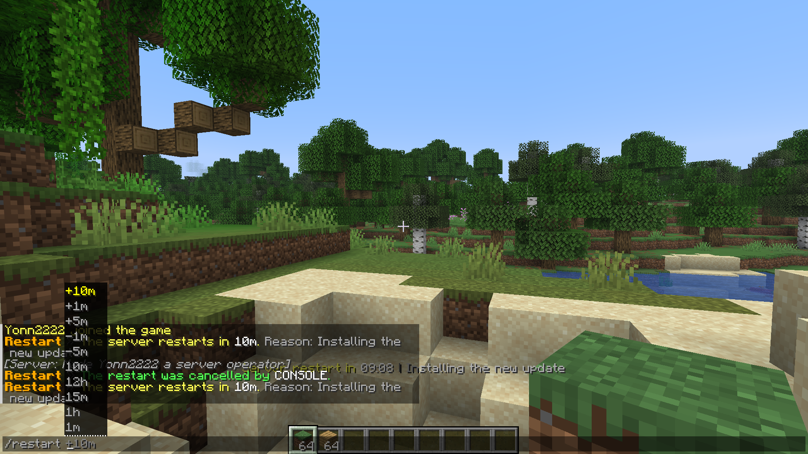

<p align="center">
  <picture>
    <source media="(prefers-color-scheme: dark)" srcset="../assets/icons/commands-dark.svg">
    
  </picture>
</p>

<h1 align="center">Commands and permissions</h1>

<p align="center">Everything you can type, and who may type it.</p>

<p align="center"><a href="README.md">All docs</a></p>

## Commands

| Command | Permission | What it does |
|---|---|---|
| `/restart <time> [reason]` | `betterrestarts.restart` | Start a countdown, or update the running one |
| `/restart +<time>` | `betterrestarts.restart` | Make the running countdown longer |
| `/restart -<time>` | `betterrestarts.restart` | Make the running countdown shorter |
| `/restart cancel` | `betterrestarts.cancel` | Cancel the running countdown |
| `/restart status` | `betterrestarts.status` | Show the countdown and the next automatic restart |
| `/restart reload` | `betterrestarts.reload` | Reload the config and the language files |

The console may always use every command. The command name and the alias `/brestart` can be changed, see [Configuration](configuration.md#command).



## Time format

| Input | Meaning |
|---|---|
| `now` | Restart immediately |
| `30s` | 30 seconds |
| `5m`, `5min` | 5 minutes |
| `1h` | 1 hour |
| `1h30m` | 1 hour 30 minutes |
| `2d` | 2 days |
| `5` | A bare number means minutes |

Units: `s`, `m`, `h`, `d` and the long forms `sec`, `min`, `hour`, `day` (also plural). The longest allowed time is set with `max-time`, 24 hours by default.

Tab completion suggests common times, adds units while you type digits and offers `+5m` or `-1m` while a countdown is running.



## Reason

Everything after the time is the reason. It is shown in the action bar, in chat and in the titles.

```
/restart 10m Installing the new update
```

## Changing a running countdown

Run `/restart` with a new time while a countdown is running. The countdown is replaced and you see the old and the new time. If you leave out the reason, the old reason is kept.

```
/restart 5m
/restart +5m
/restart -1m
```

`-` can never end the countdown. If the result would be zero or less you get an error, use `now` or `/restart cancel` instead.

## Permissions

All permissions default to operators. They work with any permissions plugin, give them to a group or a single player like any other permission.

| Permission | Allows |
|---|---|
| `betterrestarts.restart` | `/restart <time>`, `+time` and `-time` |
| `betterrestarts.cancel` | `/restart cancel` |
| `betterrestarts.status` | `/restart status` |
| `betterrestarts.reload` | `/restart reload` |
| `betterrestarts.*` | All of the above |

Players only see the sub commands they are allowed to use in tab completion.
