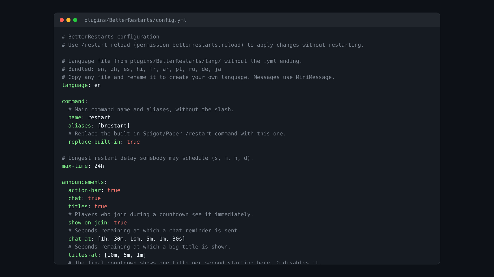

  <picture>
    <source media="(prefers-color-scheme: dark)" srcset="../assets/icons/config-dark.svg">
    
  </picture>

<h1 align="center">Configuration reference</h1>

Every option in config.yml.

<a href="README.md">All docs</a>

Apply changes with `/restart reload`. Only `command.name`, `command.aliases` and `command.replace-built-in` need a server restart.

## General

| Option | Default | Description |
|---|---|---|
| `language` | `en` | Language file from `plugins/BetterRestarts/lang/`, see [Languages](languages.md) |
| `max-time` | `24h` | Longest delay somebody may schedule |

## command

| Option | Default | Description |
|---|---|---|
| `command.name` | `restart` | Main command name without the slash |
| `command.aliases` | `[brestart]` | Aliases |
| `command.replace-built-in` | `true` | Replace the built-in Spigot and Paper `/restart` |

## announcements

See [Countdown and announcements](countdown.md).

| Option | Default |
|---|---|
| `announcements.action-bar` | `true` |
| `announcements.chat` | `true` |
| `announcements.titles` | `true` |
| `announcements.show-on-join` | `true` |
| `announcements.chat-at` | `[1h, 30m, 10m, 5m, 1m, 30s]` |
| `announcements.titles-at` | `[10m, 5m, 1m]` |
| `announcements.countdown-from` | `10` |

## title-times

Values in seconds, see [Countdown and announcements](countdown.md#title-timings).

| Option | Default |
|---|---|
| `title-times.announce.fade-in` | `0.25` |
| `title-times.announce.stay` | `3.0` |
| `title-times.announce.fade-out` | `0.5` |
| `title-times.countdown.fade-in` | `0.0` |
| `title-times.countdown.stay` | `1.1` |
| `title-times.countdown.fade-out` | `0.1` |

## sounds

| Option | Default | Description |
|---|---|---|
| `sounds.enabled` | `true` | Play sounds |
| `sounds.tick` | `block.note_block.pling` | Sound for titles and the countdown |
| `sounds.final` | `entity.ender_dragon.growl` | Sound when the restart starts |
| `sounds.volume` | `1.0` | Volume |
| `sounds.pitch` | `1.0` | Pitch |
| `sounds.urgent-pitch` | `1.6` | Pitch for the last three seconds |

## restart

See [Restart methods](restart-methods.md) and [Pterodactyl and Pelican](pterodactyl-pelican.md).

| Option | Default | Description |
|---|---|---|
| `restart.method` | `shutdown` | `shutdown`, `spigot`, `panel` or `command` |
| `restart.kick-players` | `true` | Kick everybody before the restart |
| `restart.delay-ticks` | `40` | Ticks between the "restarting" title and the kick |
| `restart.command` | `stop` | Console command for the `command` method |
| `restart.panel.url` | empty | Address of the panel |
| `restart.panel.server-id` | empty | Short ID of the server |
| `restart.panel.api-key` | empty | Client API key, or use `BETTERRESTARTS_PANEL_KEY` |

## schedule

See [Automatic restarts](schedule.md).

| Option | Default |
|---|---|
| `schedule.enabled` | `false` |
| `schedule.timezone` | `system` |
| `schedule.times` | `["04:00"]` |
| `schedule.days` | `[]` |
| `schedule.announce-before` | `10m` |
| `schedule.reason` | `Scheduled restart` |

Invalid values in the config are ignored with a warning in the log, the default is used instead.
