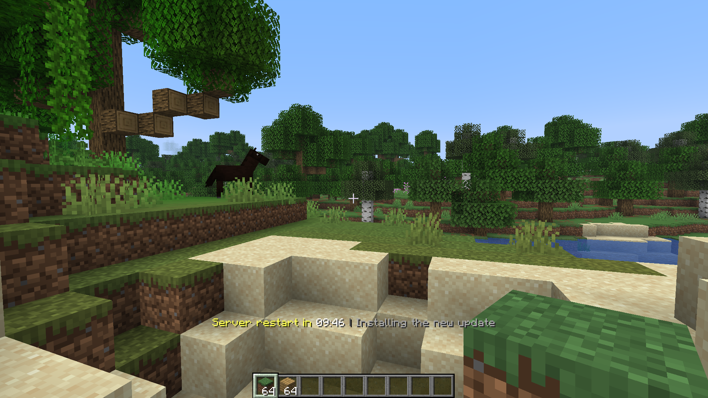
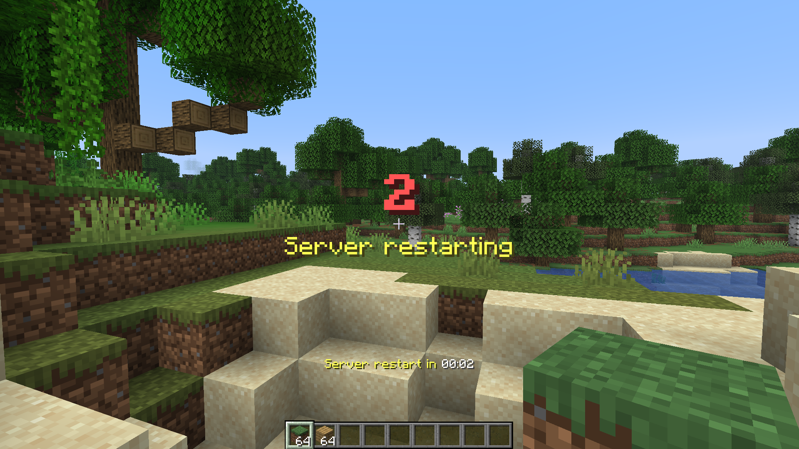
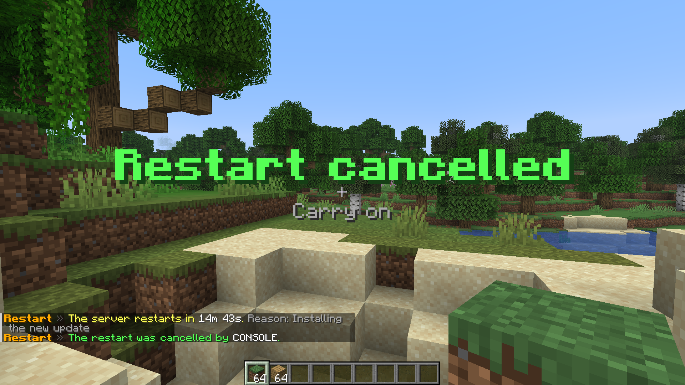

<p align="center">
  <picture>
    <source media="(prefers-color-scheme: dark)" srcset="../assets/icons/countdown-dark.svg">
    
  </picture>
</p>

<h1 align="center">Countdown and announcements</h1>

<p align="center">What your players see, and how to tune it.</p>

<p align="center"><a href="README.md">All docs</a></p>

## What happens

When a restart is scheduled:

1. A chat message announces the restart and the reason.
2. If the time left is within the largest value of `titles-at`, a title is shown right away.
3. The action bar shows the remaining time every second, for everybody online.
4. Chat reminders appear at the times in `chat-at`.
5. Titles appear at the times in `titles-at`. The defaults are 10, 5 and 1 minute.
6. For the last `countdown-from` seconds a big number is shown every second, with a sound that gets higher in the last three seconds.
7. At zero a "restarting" title is shown, everybody is kicked after `delay-ticks` and the restart follows one second later.

Players who join during a countdown get the chat message and the action bar one second after joining, if `show-on-join` is on.

Cancelling shows a chat message and a title, and clears the action bar.








## Settings

```yaml
announcements:
  action-bar: true
  chat: true
  titles: true
  show-on-join: true
  chat-at: [1h, 30m, 10m, 5m, 1m, 30s]
  titles-at: [10m, 5m, 1m]
  countdown-from: 10
```

| Option | Effect |
|---|---|
| `action-bar` | The action bar countdown |
| `chat` | Chat messages and reminders |
| `titles` | All titles, including the final countdown |
| `show-on-join` | Show the countdown to players who join later |
| `chat-at` | Remaining times that send a chat reminder |
| `titles-at` | Remaining times that show a title |
| `countdown-from` | Where the second by second countdown starts, `0` turns it off |

Times use the same format as the [commands](commands.md#time-format).

## Title timings

All values are in seconds.

```yaml
title-times:
  announce:
    fade-in: 0.25
    stay: 3.0
    fade-out: 0.5
  countdown:
    fade-in: 0.0
    stay: 1.1
    fade-out: 0.1
```

## Sounds

```yaml
sounds:
  enabled: true
  tick: block.note_block.pling
  final: entity.ender_dragon.growl
  volume: 1.0
  pitch: 1.0
  urgent-pitch: 1.6
```

Use any sound key from the [Minecraft wiki](https://minecraft.wiki/w/Sounds.json). `urgent-pitch` is used for the last three seconds.

## Texts

All texts live in the [language files](languages.md).

## Bedrock players

Titles, the action bar and chat are sent the normal Bukkit way, so Bedrock players on Geyser should see them like Java players. Commands typed on Bedrock go through Geyser like any other command.
