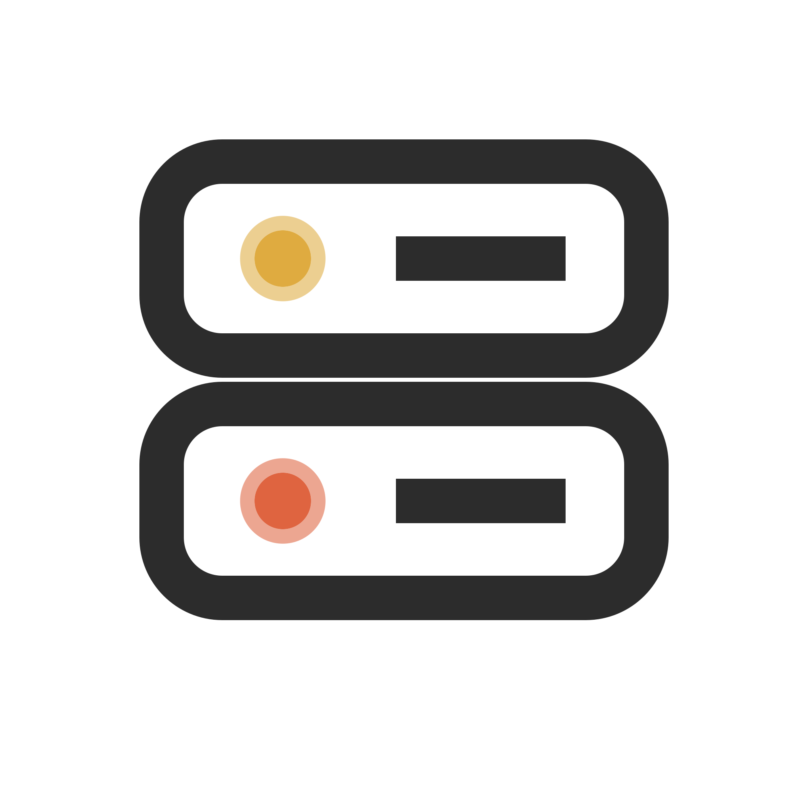

<p align="center">
  <picture>
    <source media="(prefers-color-scheme: dark)" srcset="../assets/icons/panel-dark.svg">
    
  </picture>
</p>

<h1 align="center">Pterodactyl and Pelican</h1>

<p align="center">Make the panel bring the server back up.</p>

<p align="center"><a href="README.md">All docs</a></p>

## The easy way: do nothing

With the default `restart.method: shutdown` the server stops by itself. Wings, the daemon of Pterodactyl and Pelican, treats a stop that did not come from the panel as a crash and starts the server again. In the Wings configuration this is the option `detect_clean_exit_as_crash`, which is `true` by default. Between two automatic restarts Wings waits for the crash `timeout`, 60 seconds by default. Crash detection must be on for the server.

Try it with `/restart 10s`. If the server comes back, you are done.

## Let the panel restart it

If the server stays offline, use the panel method. BetterRestarts then asks the panel to restart the server, like the restart button does.

1. Open your account in the panel and create a client API key (API credentials). The key is shown only once. The menu name can differ between panel versions.
2. Find the short server ID. It is the part after `/server/` in the URL of the server console, for example `d3aac109`.
3. Edit the config:

```yaml
restart:
  method: panel
  panel:
    url: https://panel.example.com
    server-id: d3aac109
    api-key: ptlc_xxxxxxxxxxxxxxxxxxxxxxxxxxxx
```

Apply with `/restart reload`.

## Keep the key out of the config

Leave `api-key` empty and set the environment variable `BETTERRESTARTS_PANEL_KEY` for the server process instead.

## What it sends

A `POST` to `<url>/api/client/servers/<server-id>/power` with the body `{"signal":"restart"}` and your key as bearer token. A successful call returns HTTP 204.

## If something fails

If the panel is not configured, cannot be reached or answers with an error, the log shows a warning and the server is shut down instead, so the restart still happens.

## Notes

The endpoint is documented for Pterodactyl. Pelican is based on it and uses the same client API. If something does not work, open an issue.
