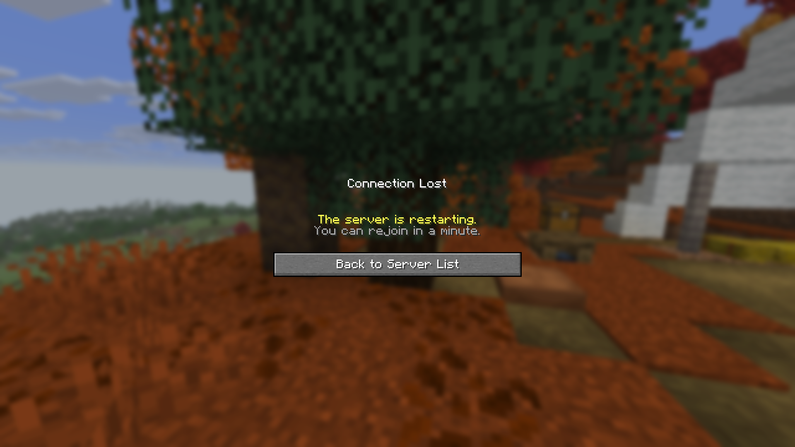

<p align="center">
  <picture>
    <source media="(prefers-color-scheme: dark)" srcset="../assets/icons/methods-dark.svg">
    
  </picture>
</p>

<h1 align="center">Restart methods</h1>

<p align="center">Minecraft cannot start itself, so choose who does it.</p>

<p align="center"><a href="README.md">All docs</a></p>

BetterRestarts can only stop the server. Minecraft cannot start itself again, so your host, panel or start script has to bring it back up. Most hosts do this by default.

The option `restart.method` tells BetterRestarts how to end the server.

| Method | Use it when |
|---|---|
| `shutdown` | Default. A panel, systemd or a Docker restart policy starts the server again |
| `spigot` | You use a start script and set `restart-script` in `spigot.yml` |
| `panel` | Pterodactyl or Pelican should be asked to restart the server, see [Pterodactyl and Pelican](pterodactyl-pelican.md) |
| `command` | You want to run any console command |

## shutdown

The server is stopped like with `/stop`. Whatever supervises the server decides what happens next.

- Most game panels start a stopped server again, see [Pterodactyl and Pelican](pterodactyl-pelican.md).
- With systemd use `Restart=always`.
- With Docker use `restart: unless-stopped` or `always`.

## spigot

Uses the restart of Spigot. It starts the script from `settings.restart-script` in `spigot.yml`. If the script does not exist, the server only stops, which is the same as `shutdown`.

## command

Runs `restart.command` as the console. The default is `stop`. Use it for a custom command or script hook, for example from another plugin.

## panel

Calls the client API of your panel, see [Pterodactyl and Pelican](pterodactyl-pelican.md).

## Kick and timing




```yaml
restart:
  kick-players: true
  delay-ticks: 40
```

At the end of the countdown a "restarting" title is shown. After `delay-ticks` (20 ticks are one second) all players are kicked with the `kick` message, and one second later the restart method runs. Turn off `kick-players` if you want the server to handle that itself.

## The /restart command

By default BetterRestarts removes the built-in Spigot and Paper `/restart` and registers its own. Set `command.replace-built-in: false` to keep the old one. Then BetterRestarts is still available as `/betterrestarts:restart` and `/brestart`.
